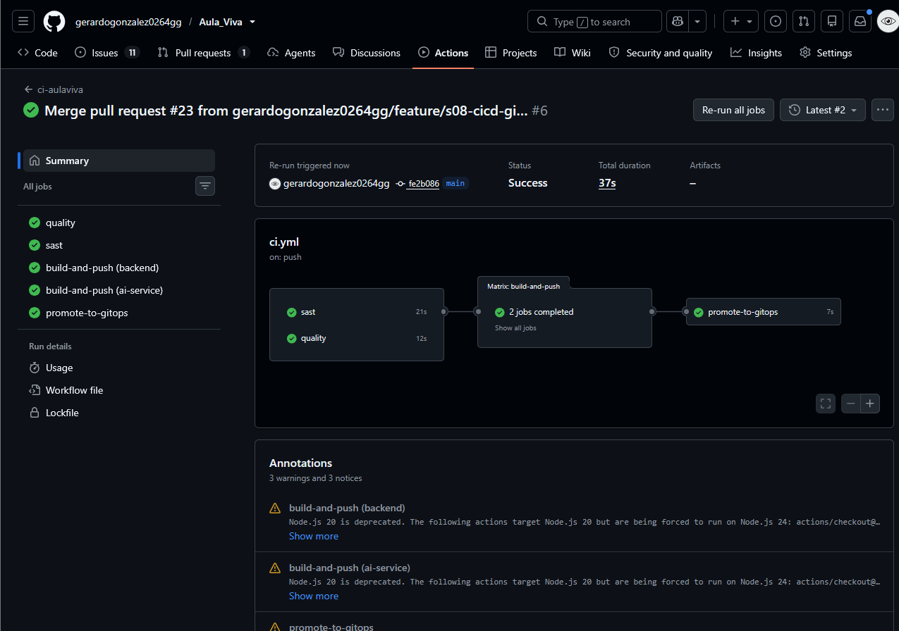
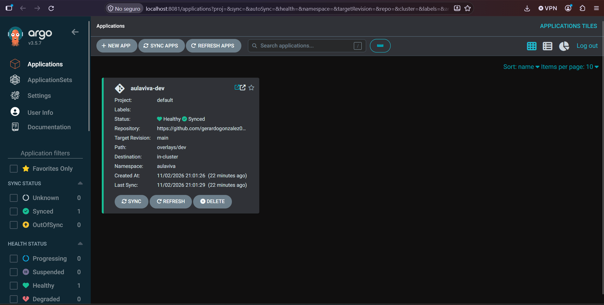
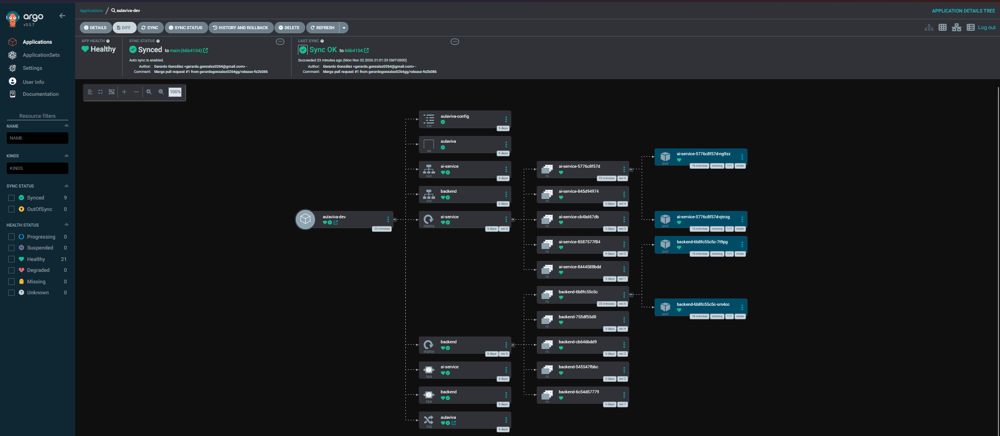
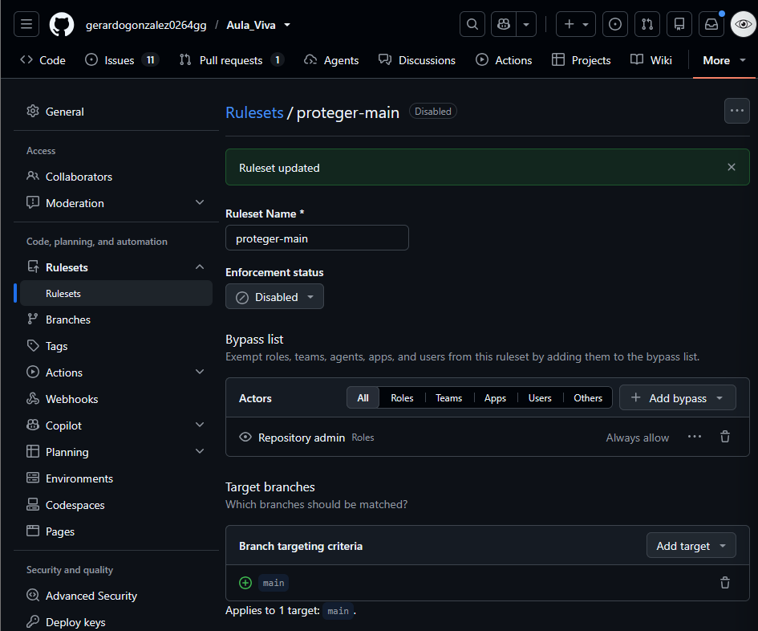

## CI/CD y GitOps (S08)

- El pipeline está en `.github/workflows/ci.yml` (revisión de código, pruebas con 70% de cobertura, Semgrep e imágenes en GHCR).
- Los manifiestos de despliegue viven en el repositorio `aulaviva-gitops` y Argo CD los aplica solo.
- Decisiones: ver `docs/adr/0005-gitops-strategy.md`.

Pipeline en verde en `main`:

Argo CD con la aplicación en Synced/Healthy:

Árbol de recursos en Argo CD (todo en verde):

Protección de la rama `main` (2 aprobaciones y checks obligatorios):

