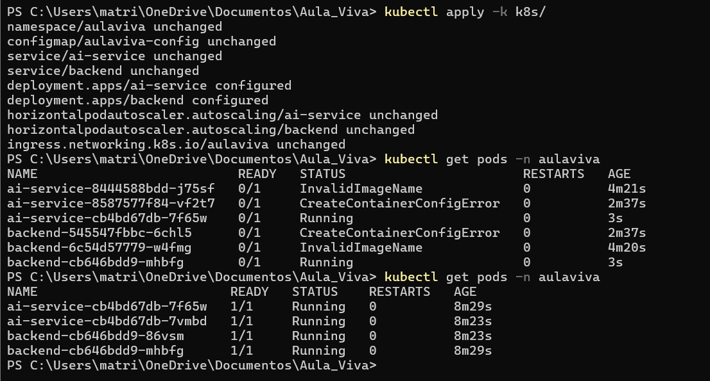
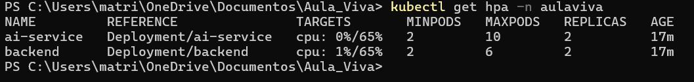
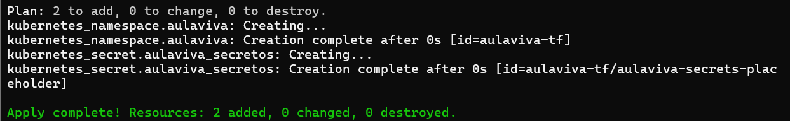

# AulaViva

## Descripción

AulaViva es un proyecto de plataforma educativa orientado al apoyo de la enseñanza y el aprendizaje mediante herramientas digitales.

El proyecto busca desarrollar una solución que permita centralizar diferentes actividades relacionadas con la educación, facilitando la interacción entre docentes y estudiantes.

## Propósito

El propósito general de AulaViva es proporcionar una plataforma que apoye los procesos educativos mediante funcionalidades digitales que puedan ser desarrolladas y ampliadas durante las distintas etapas del proyecto.

## Alcance

El proyecto contempla el desarrollo progresivo de una plataforma educativa.

Durante el desarrollo se definirán:

- Requisitos del sistema.
- Usuarios y funcionalidades.
- Arquitectura de software.
- Componentes del sistema.
- Seguridad.
- Gestión de datos.
- Pruebas.
- Despliegue.
- Documentación técnica.

## Usuarios

La plataforma considera principalmente:

- Docentes.
- Estudiantes.

Las funcionalidades específicas de cada usuario serán definidas durante el levantamiento y priorización de requisitos.

## Arquitectura

La arquitectura del sistema será definida durante el desarrollo del proyecto, considerando las necesidades funcionales y técnicas identificadas.

Se documentarán las principales decisiones arquitectónicas y la evolución de la solución.

## Desarrollo

El proyecto será desarrollado de manera incremental, utilizando control de versiones y ramas para organizar los diferentes avances.

Las funcionalidades y cambios específicos serán desarrollados en ramas independientes y posteriormente integrados a la rama principal cuando corresponda.

## Documentación

La documentación detallada del proyecto se incorporará progresivamente durante las diferentes etapas de desarrollo.

## Estado

Proyecto en desarrollo.

## Estructura del repositorio

| Carpeta o archivo | Qué contiene |
|---|---|
| `api/` | Contrato OpenAPI de la API |
| `docs/` | Documentación (ADR, C4, datos, backlog, 12-factor) |
| `backend/` | Backend (Node.js) y su Dockerfile |
| `ai-service/` | Servicio IA (Python) y su Dockerfile |
| `k8s/` | Manifiestos de Kubernetes (se aplican con Kustomize) |
| `terraform/` | Infraestructura como código |
| `.github/workflows/` | Pipelines de GitHub Actions |
| `docker-compose.yml` | Para levantar todo en el computador |

## Cómo ejecutar en el computador

```bash
docker compose up --build
```

- Backend: http://localhost:8080/health
- Servicio IA: http://localhost:8081/health

## Despliegue en Kubernetes (S07)

```bash
kind create cluster --name aulaviva
kubectl apply -k k8s/
kubectl get all -n aulaviva
```

Resultado de `kubectl get all -n aulaviva`:



Autoescalado (HPA):



Terraform:



Decisiones: ver `docs/adr/0005-plataforma-k8s.md`.

## CI/CD y GitOps (S08)

- El pipeline está en `.github/workflows/ci.yml` (revisión de código, pruebas con 70% de cobertura, Semgrep e imágenes en GHCR).
- Los manifiestos de despliegue viven en el repositorio `aulaviva-gitops` y Argo CD los aplica solo.
- Decisiones: ver `docs/adr/0006-gitops-strategy.md`.

Argo CD con la aplicación en Synced/Healthy:


## Decisiones de arquitectura (ADR)

| ADR | Tema |
|---|---|
| 0001 | Elección de la iniciativa |
| 0002 | Estilo arquitectónico |
| 0003 | Despliegue en la nube |
| 0004 | Datos y eventos |
| 0005 | Contenedores, Kubernetes e IaC |
| 0006 | CI/CD y GitOps |

## Autor

Gerardo González
