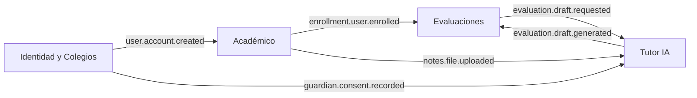

# Bounded Contexts - AulaViva

Un "bounded context" es una zona del sistema donde las palabras tienen un solo significado.
En AulaViva la palabra **"estudiante"** no significa lo mismo en todas partes,
por eso separamos el sistema en 4 zonas.

## 1. Identidad y Colegios

- **Qué hace:** guarda los colegios (tenants), los usuarios y el consentimiento de los apoderados.
- **Qué significa "estudiante" aquí:** una persona con cuenta, un colegio y (si es menor) el permiso firmado por su apoderado.
- **Dato principal:** `School` (colegio con sus usuarios).
- **Motor de datos:** PostgreSQL.

## 2. Académico

- **Qué hace:** maneja los cursos, las matrículas y los apuntes que sube el docente.
- **Qué significa "estudiante" aquí:** alguien matriculado en un curso.
- **Dato principal:** `Course` (curso con sus matrículas y apuntes).
- **Motor de datos:** PostgreSQL.

## 3. Evaluaciones

- **Qué hace:** crea evaluaciones, recibe las respuestas, las corrige solas y entrega resultados y feedback.
- **Qué significa "estudiante" aquí:** quien responde una evaluación y recibe una nota.
- **Dato principal:** `Evaluation` (evaluación con sus preguntas y respuestas enviadas).
- **Motor de datos:** PostgreSQL.

## 4. Tutor IA

- **Qué hace:** responde preguntas usando los apuntes del curso (RAG) y mide cuántos tokens gasta cada colegio.
- **Qué significa "estudiante" aquí:** quien hace una pregunta al tutor. Solo se guarda una referencia, no sus datos personales.
- **Dato principal:** `TutorSession` (conversación con el tutor).
- **Motor de datos:** PostgreSQL con pgvector (guarda los textos de los apuntes para buscarlos).

## Mapa de contexto (cómo se hablan)

## Reglas simples

- Una zona no lee las tablas de otra. Se comunican por eventos o por la API.
- Todas las tablas y eventos llevan `tenant_id`, para que un colegio nunca vea datos de otro.
- Las 4 zonas viven dentro del mismo monolito modular (ADR 0002), pero cada una es un módulo separado.
